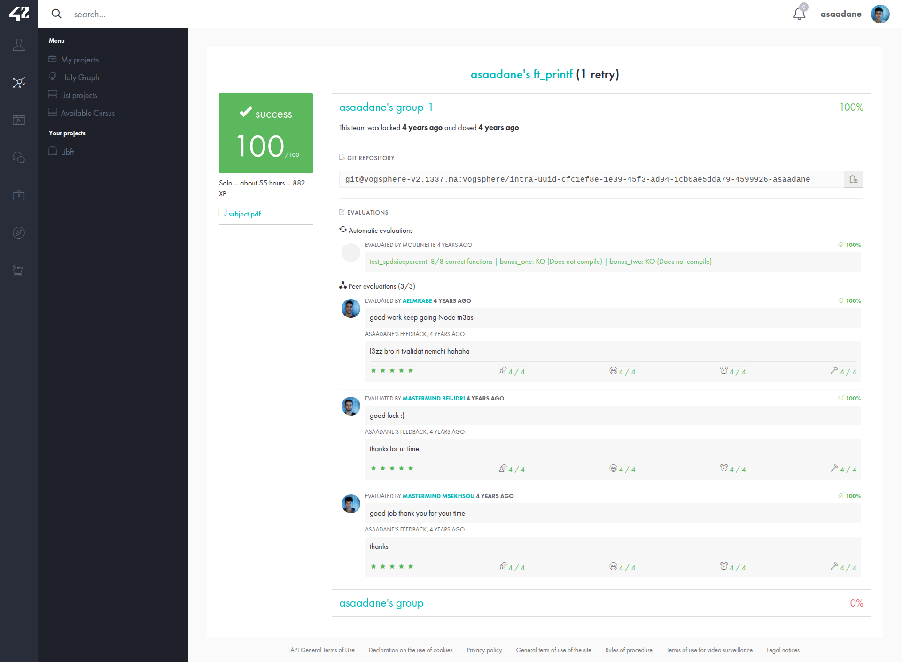
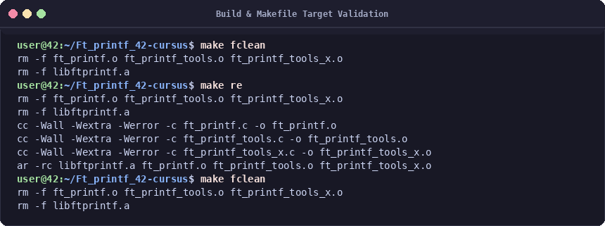
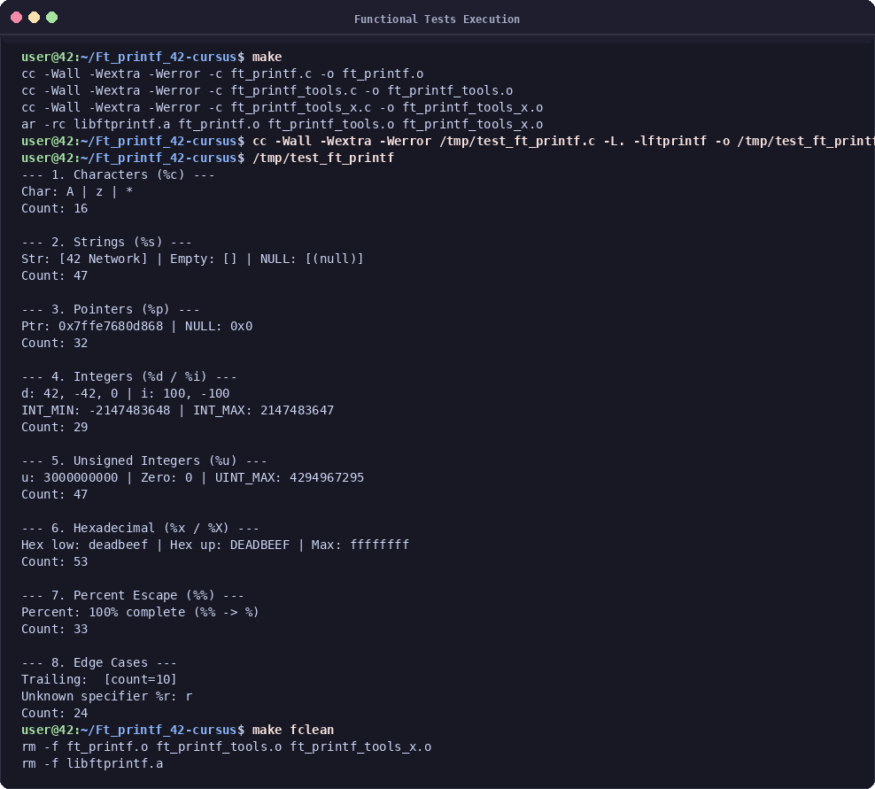
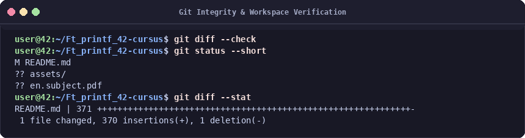

# ft_printf

A lightweight, unbuffered re-implementation of the standard C library `printf` function, developed as part of the **42 Network** curriculum.

[](#technologies-and-tools)
[](#42-cursus-context)
[](#project-overview)
[](#supported-conversions)
[](#validation-evidence)

<p align="center">
  
</p>

---

## Table of Contents

- [Project Overview](#project-overview)
- [42 Cursus Context](#42-cursus-context)
- [Supported Conversions](#supported-conversions)
- [Scope and Limitations](#scope-and-limitations)
- [Implementation Architecture](#implementation-architecture)
- [Source File Responsibilities](#source-file-responsibilities)
- [Repository Structure](#repository-structure)
- [Technologies and Tools](#technologies-and-tools)
- [Project Statistics](#project-statistics)
- [Prerequisites](#prerequisites)
- [Installation and Compilation](#installation-and-compilation)
- [Usage and Linking](#usage-and-linking)
- [Testing and Verification](#testing-and-verification)
- [Validation Evidence](#validation-evidence)
- [Known Platform Differences and Edge Cases](#known-platform-differences-and-edge-cases)
- [Learning Outcomes](#learning-outcomes)
- [Author](#author)
- [License](#license)

---

## Project Overview

`ft_printf` is a foundational systems programming project in the 42 curriculum. The objective is to reproduce the essential formatting and output capabilities of the standard C `printf` function from `<stdio.h>`.

The resulting software is compiled into a static library (`libftprintf.a`) that can be integrated into subsequent C projects, serving as a reusable, dependency-free formatting utility.

---

## 42 Cursus Context

In the 42 curriculum, students are challenged to rebuild fundamental standard library utilities from scratch to develop an intuitive understanding of low-level concepts:

- Handling variadic arguments in C (`<stdarg.h>`).
- Direct operating system input/output using the POSIX `write` system call.
- String parsing and recursive base-n numeric representation.
- Static library generation and modular Makefile design under strict compiler constraints (`-Wall -Wextra -Werror`).

---

## Supported Conversions

This implementation provides complete support for all **9 mandatory format specifiers** required by the 42 `ft_printf` subject:

| Specifier | Description | Argument Type | Output Format / Example |
| :---: | :--- | :--- | :--- |
| `%c` | Single character | `int` (promoted `char`) | Writes a single byte (e.g., `'a'`) |
| `%s` | String of characters | `char *` | Outputs character array; prints `(null)` if pointer is `NULL` |
| `%p` | Void pointer address | `void *` | Hexadecimal memory address prefixed by `0x` (e.g., `0x7ffee4b2a8`) |
| `%d` | Signed decimal integer | `int` | Base 10 integer, handles negative values and `INT_MIN` |
| `%i` | Signed integer | `int` | Base 10 signed integer (identical to `%d`) |
| `%u` | Unsigned decimal integer | `unsigned int` | Base 10 unsigned value (0 to `4294967295`) |
| `%x` | Lowercase hexadecimal | `unsigned int` | Base 16 lowercase representation using `0123456789abcdef` |
| `%X` | Uppercase hexadecimal | `unsigned int` | Base 16 uppercase representation using `0123456789ABCDEF` |
| `%%` | Literal percent sign | None | Escapes and prints a single `%` character |

---

## Scope and Limitations

To maintain clarity and accurate expectations, please note the scope of this implementation:

- **Mandatory Scope Only:** Implements the core 9 conversion specifiers listed above.
- **No Format Flags:** Flags such as `-`, `+`, `0`, `#`, and `' '` (space) are **not** supported.
- **No Field Width:** Minimum field width specifications (e.g., `%10d`) are **not** supported.
- **No Precision:** Precision modifiers (e.g., `%.2f`, `%.5s`) are **not** supported.
- **No Length Modifiers:** Sub-specifiers such as `h`, `hh`, `l`, `ll`, `j`, `z`, or `t` are **not** supported.
- **No Floating-Point Support:** Floating-point specifiers (`%f`, `%e`, `%g`, `%a`) are **not** implemented.
- **Standard Library Equivalence:** This library is a focused educational recreation for standard integer, pointer, character, and string output; it does not claim full POSIX/C99 `printf` compliance across all specifications.

---

## Implementation Architecture

```text
                     +--------------------+
                     |   ft_printf(...)   |
                     +---------+----------+
                               |
            +------------------+------------------+
            |                                     |
     [Normal Character]                    [Specifier '%']
            |                                     |
            |                              ft_check_symb()
            |                                     |
            |   +--------+------------------------+--------+--------+
            |   |        |                        |        |        |
            |  %c, %%   %s                    %d, %i, %u  %x, %X    %p
            |   |        |                        |        |        |
            |   |    ft_put_str()                 |        |    ft_put_str("0x")
            |   |        |                        |        |    ft_put_ptr()
            |   |        |     +------------------+        |        |
            |   |        |     |                  |        |        |
            |   |        |  ft_put_nbr()   ft_put_unbr()   |        |
            |   |        |     |                  |        |        |
            |   |        |     |      +-----------+--------+        |
            |   |        |     |      |                    |        |
            |   |        |     |  ft_put_lowhex()   ft_put_uphex()  |
            |   |        |     |      |                    |        |
            +---+--------+-----+------+--------------------+--------+
                                      |
                                ft_put_char()
                                      |
                               write(1, &c, 1)
                                *lenght += 1
```

### Architectural Highlights

1. **Unbuffered Streaming Output:**
   Characters are written directly to standard output (`STDOUT_FILENO`, file descriptor `1`) using `write(1, &c, 1)` or string literals (such as `"-2147483648"` for `INT_MIN`). No large intermediate heap buffers are allocated.

2. **Pointer-Based Character Counting:**
   The cumulative written byte count is maintained through an integer pointer (`int *lenght`) propagated through the call chain. Each write operation immediately increments this counter.

3. **Zero Dynamic Memory Allocation:**
   The entire library operates without a single call to `malloc`, `calloc`, `realloc`, or `free`. This eliminates the risk of heap memory leaks or allocation failures.

4. **Recursive Radix Decomposition:**
   Numeric representations (`%d`, `%i`, `%u`, `%x`, `%X`, `%p`) are rendered via recursion. The stack depth is strictly bounded:
   - Maximum 10 frames for 32-bit decimal integers.
   - Maximum 8 frames for 32-bit hexadecimal integers.
   - Maximum 16 frames for 64-bit pointer addresses.

---

## Source File Responsibilities

| File / Directory | Primary Responsibility | Key Functions / Contents |
| :--- | :--- | :--- |
| `ft_printf.h` | Header declarations, macros, standard includes | Prototypes for library functions |
| `ft_printf.c` | Entry point, variadic lifecycle, and specifier dispatcher | `ft_printf`, `ft_check_symb` |
| `ft_printf_tools.c` | Basic character, string, and base-10 integer output | `ft_put_char`, `ft_put_str`, `ft_put_nbr`, `ft_put_unbr` |
| `ft_printf_tools_x.c` | Base-16 hexadecimal and memory pointer formatting | `ft_put_lowhex`, `ft_put_uphex`, `ft_put_ptr` |
| `Makefile` | Build configuration and archive generation | Targets: `all`, `clean`, `fclean`, `re` |
| `en.subject.pdf` | Official 42 project subject specification | Project requirements and grading rules |
| `assets/validation/` | Visual validation captures and evidence assets | Evaluation grade, build, test, and git captures |

---

## Repository Structure

```
Ft_printf_42-cursus/
├── assets/
│   └── validation/
│       ├── build-validation.png  # Build, compiler flags, and target verification
│       ├── ft_printf-100.png     # Official 42 peer-evaluation result (100%)
│       ├── functional-tests.png  # Functional test execution for all conversions
│       └── git-integrity.png     # Git workspace and diff integrity verification
├── en.subject.pdf                # Official 42 ft_printf project subject specification
├── Makefile                      # Build automation script
├── README.md                     # Project documentation
├── ft_printf.c                   # Core parsing loop and dispatcher
├── ft_printf.h                   # Function prototypes and definitions
├── ft_printf_tools.c             # Character, string, and integer printing tools
└── ft_printf_tools_x.c           # Hexadecimal and pointer address printing tools
```

---

## Technologies and Tools

- **Language:** C
- **Compiler:** `cc` (tested with GCC 14.2)
- **Compiler Flags:** `-Wall -Wextra -Werror`
- **Archiver:** `ar` (`ar -rc`)
- **System Interface:** POSIX `write(2)` system call
- **Variadic Interface:** Standard `<stdarg.h>` (`va_list`, `va_start`, `va_arg`, `va_end`)

---

## Project Statistics

- **C Source Files:** 3 (`ft_printf.c`, `ft_printf_tools.c`, `ft_printf_tools_x.c`)
- **Header Files:** 1 (`ft_printf.h`)
- **Total Lines of C Code:** ~231 lines (concise, modular footprint)
- **Output Artifact:** Static library `libftprintf.a`

---

## Prerequisites

To compile and use this library, ensure you have a standard POSIX-compatible environment with:

- A C compiler (`cc`, `gcc`, or `clang`)
- GNU Make (`make`)
- Standard archive utility (`ar`)

On Debian / Ubuntu:
```bash
sudo apt-get update && sudo apt-get install build-essential
```

On macOS:
```bash
xcode-select --install
```

---

## Installation and Compilation

The project uses a standard `Makefile` configured with strict compiler flags (`-Wall -Wextra -Werror`).

### Build Targets

Build the static library `libftprintf.a`:
```bash
make
```

Remove intermediate object files (`*.o`):
```bash
make clean
```

Remove object files and the generated `libftprintf.a` library:
```bash
make fclean
```

Perform a complete rebuild from scratch:
```bash
make re
```

---

## Usage and Linking

### 1. Include the Header in Your C Source

Create a sample program (e.g., `main.c`):

```c
#include "ft_printf.h"

int main(void)
{
    int             count;
    char            character = 'A';
    char            *string = "42 Network";
    int             number = -42;
    unsigned int    unsigned_number = 3000000000U;
    void            *pointer = &number;

    count = ft_printf("Char: %c | String: %s\n", character, string);
    ft_printf("Decimal: %d | Unsigned: %u\n", number, unsigned_number);
    ft_printf("Hex: %x | HEX: %X | Pointer: %p\n", 255, 255, pointer);
    ft_printf("Percent: %%\n");

    ft_printf("Total characters printed in first call: %d\n", count);
    return (0);
}
```

### 2. Compile and Link

Compile your application with `libftprintf.a`:

```bash
# 1. Build the library
make

# 2. Compile and link with your source code
cc main.c -L. -lftprintf -o demo

# 3. Run the executable
./demo
```

---

## Testing and Verification

### Verification Status

- **Build Verification:** The repository compiles without warnings or errors under GCC 14.2 on Debian Linux with `-Wall -Wextra -Werror`.
- **Target Verification:** Object cleanup (`clean`), complete removal (`fclean`), and recompilation (`re`) targets were tested and execute cleanly without lingering artifacts.
- **Local Scratch Tests:** Basic formatting for the 9 supported specifiers (`%c`, `%s`, `%p`, `%d`, `%i`, `%u`, `%x`, `%X`, `%%`) and select test values (including `INT_MIN`, `INT_MAX`, `UINT_MAX`, empty string `""`, and `NULL` string pointers) was executed locally in an isolated test runner to check basic output and character counts against glibc `printf`. These tests were run for verification during repository audits and do not represent a comprehensive test suite or guarantee full standard library compatibility across untested inputs.
- **Permanent Test Suite:** This repository does not contain an integrated automated test suite. Third-party 42 community test suites (such as `francinette` or `tripouille`) can be run externally against `libftprintf.a`.

---

## Validation Evidence

The following captures demonstrate verifiable evidence of 42 evaluation results, compilation, functional execution, and repository integrity:

### 1. 42 Project Evaluation (100% Score)
Official 42 Network project peer-evaluation result verifying a 100% grade on the mandatory project scope:

<p align="center">
  
</p>

### 2. Build and Makefile Validation
Demonstrates clean execution of `make fclean`, followed by a full rebuild with `make re` (highlighting compiler invocation `cc -Wall -Wextra -Werror` and archive creation `ar -rc libftprintf.a`), and cleanup with `make fclean`:



### 3. Functional Test Execution
Demonstrates compilation of a test harness against `libftprintf.a` validating all 9 mandatory conversions (`%c`, `%s`, `%p`, `%d`, `%i`, `%u`, `%x`, `%X`, `%%`) and edge cases (`INT_MIN`, `INT_MAX`, `UINT_MAX`, empty strings, NULL pointers):



### 4. Git Integrity Verification
Confirms repository hygiene via `git diff --check`, `git status --short`, and `git diff --stat`, verifying that core C implementation files and Makefile remain strictly untouched:



---

## Known Platform Differences and Edge Cases

1. **`%p` with `NULL` Pointer:**
   - When formatting a `NULL` pointer (`%p`), this implementation outputs `0x0`.
   - On Linux systems with standard GNU C Library (`glibc`), `printf` formats a `NULL` pointer as `(nil)`. This is an observed platform difference.

2. **`%s` with `NULL` Pointer:**
   - When passing a `NULL` string pointer, this implementation outputs `(null)`, matching standard glibc behavior.

3. **Trailing `%` Character:**
   - Format strings ending with an unmatched `%` (e.g., `"test %"`) will terminate processing and return the printed count up to that point.

4. **Unknown Conversion Specifier:**
   - An unsupported conversion specifier (e.g., `"%r"`) will print the trailing character directly (`"r"`).

---

## Learning Outcomes

Developing this project provided deep hands-on experience with:

- **Variadic Functions:** Mastering `<stdarg.h>` macros (`va_list`, `va_start`, `va_arg`, `va_end`) to construct flexible, variable-arity APIs.
- **Buffer-Free Low-Level I/O:** Interfacing directly with Unix file descriptors via `write(2)`.
- **Number System Transformations:** Implementing clean mathematical recursion for base conversions (binary/decimal to hexadecimal and ASCII string representations).
- **Static Library Packaging:** Creating reusable Unix archives (`.a`) using the `ar` utility.
- **Strict Compiler Flags:** Writing code that compiles cleanly under strict compiler flags (`-Wall -Wextra -Werror`).

---

## Author

- **Ayman Saadane** ([@Shifuuu31](https://github.com/Shifuuu31))
- **42 Intra:** `asaadane`

---

## License

No LICENSE or COPYING file is currently provided. Reuse permissions are therefore not explicitly granted.
